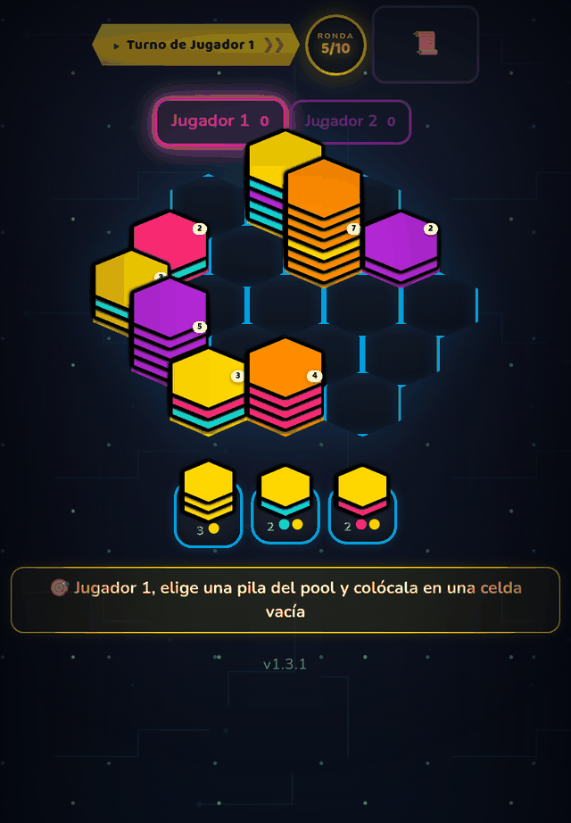

# 🔷 HexaSort Party

> Apila hexágonos por turnos en un tablero compartido y encadena fusiones de colores. Para 2 a 4 jugadores, contra amigos o contra la IA.

**[▶ Jugar ahora](https://juliangdeveloper.github.io/hexasort-party-v2/)** · gratis, en el navegador, sin instalar

## Cómo se juega
- 2 a 4 jugadores en un mismo dispositivo; cada puesto puede ser humano o IA (fácil, media o difícil).
- Hay un tablero de 19 celdas compartido y un pool de 3 pilas de colores. En tu turno colocas una pila en una celda vacía.
- Los hexágonos vecinos del mismo color se mueven a tu pila; si eso crea nuevas coincidencias, la fusión se encadena.
- Una pila con 10 o más hexágonos del mismo color desaparece y cada hexágono vale 1 punto.
- Si no queda dónde colocar, todos pierden 5 puntos y el tablero se reinicia.
- Gana el mayor puntaje tras 5, 10 o 15 rondas. Incluye tutorial y botón para compartir el resultado.

## Stack
Un solo `index.html` con HTML, CSS y JavaScript vanilla. Sin dependencias ni servidor.

## Otros juegos de fiesta
- 🌊 [Flood-It Party](https://github.com/juliangdeveloper/floodit-party) · [jugar](https://juliangdeveloper.github.io/floodit-party/)
- 💥 [Clickomania Party](https://github.com/juliangdeveloper/clickomania-party) · [jugar](https://juliangdeveloper.github.io/clickomania-party/)
- 🌿 [VidaBalance](https://github.com/juliangdeveloper/vidabalance-v2) · [jugar](https://juliangdeveloper.github.io/vidabalance-v2/)

---

Más proyectos: https://juliangdeveloper.github.io/

Hecho con ❤️ y 🔷
